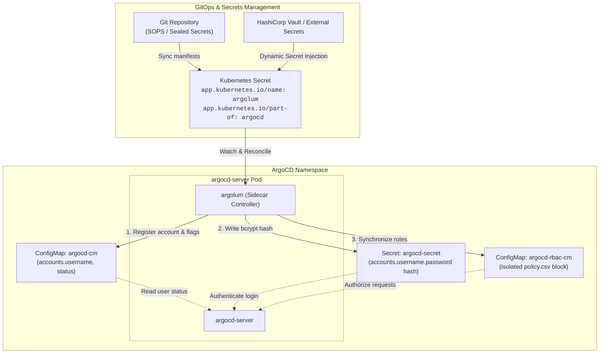

# ArgoCD Local Users Manager (`argolum`)

[](https://goreportcard.com/report/github.com/aleksandrsumkin/argolum)
[](LICENSE)

**English** | [Русский](README_RU.md)

**`argolum`** is a lightweight Kubernetes operator and sidecar controller designed for declarative, GitOps-driven management of ArgoCD local user accounts (including seamless secret provisioning via Vault Secret Operator or External Secrets Operator) without the complexity and overhead of a full ArgoCD Operator.

---

## 🎯 The Problem

In a standard ArgoCD setup, managing local user accounts is fragmented across multiple Kubernetes resources:
1. **User definition, capabilities, and status** are stored in the `argocd-cm` ConfigMap (`accounts.<username>`).
2. **User passwords** are stored inside the shared `argocd-secret` Secret as bcrypt-hashed strings (`accounts.<username>.password`).
3. **RBAC assignments and project roles** are defined in the `argocd-rbac-cm` ConfigMap (`policy.csv`).

This architectural design creates friction in modern GitOps workflows:
* **Plaintext secrets:** You cannot safely commit raw user passwords into Git.
* **Vault / KMS integration:** Dynamically synchronizing generated passwords from HashiCorp Vault or AWS Secrets Manager into the monolithic `argocd-secret` is cumbersome.
* **Credential rotation:** Regular password rotation in CI/CD pipelines typically requires manual CLI actions (`argocd account update-password`) or custom glue scripts.

---

## 🚀 The Solution

`argolum` reconciles standard Kubernetes `Opaque` Secrets labeled with:
```yaml
app.kubernetes.io/name: argolum
app.kubernetes.io/part-of: argocd
```

When a labeled Secret is created, updated, or deleted, `argolum`:
1. **Hashes passwords on-the-fly:** Calculates secure `bcrypt` hashes and updates `argocd-secret`.
2. **Provisions accounts:** Registers the user and their capabilities (`enabled`, `apiKey`, `login`) in `argocd-cm`.
3. **Applies RBAC policies:** Maps user permissions into a dedicated, isolated block of `policy.csv` in `argocd-rbac-cm`.
4. **Handles safe teardown:** Uses a Kubernetes finalizer (`argolum.argoproj.io/finalizer`) to cleanly purge credentials and RBAC rules when a Secret is deleted.
5. **Protects system accounts:** Guards built-in accounts (such as `admin`) against accidental modification or deletion.
6. **Automates reconciliation (pruning):** Periodically detects and removes orphan local accounts that no longer have a backing Secret (optional).

### 📊 Architecture & Data Flow



---

## 📋 User Secret Specification

You can find a fully commented template in [`argolum-secret-example.yaml`](argolum-secret-example.yaml):

```yaml
apiVersion: v1
kind: Secret
metadata:
  name: argocd-local-user-jenkins
  namespace: argocd
  labels:
    app.kubernetes.io/name: argolum
    app.kubernetes.io/part-of: argocd
type: Opaque
stringData:
  username: jenkins                         # Required: ArgoCD username (cannot be 'admin')
  password: myPlainSecretPassword123!       # Required: Plaintext password (hashed with bcrypt by argolum)
  enabled: "true"                           # Required: "true" | "false"
  apiKey: "true"                            # Required: Allow generating JWT API tokens
  login: "false"                            # Required: Allow UI/CLI password login ("false" for CI bots)
  roles: "proj:default:admin,role:readonly" # Optional: Comma-separated list of ArgoCD roles
```

### Field Reference

| Field | Type | Required | Description |
| :--- | :--- | :--- | :--- |
| `username` | string | **Yes** | Unique ArgoCD account name. Protected accounts like `admin` are blocked. |
| `password` | string | **Yes** | Plaintext password. `argolum` hashes it via bcrypt and writes it to `argocd-secret`. Plaintext is never exposed. |
| `enabled` | string (`"true"` / `"false"`) | **Yes** | Determines if the account is active. |
| `apiKey` | string (`"true"` / `"false"`) | **Yes** | Grants permission to generate JWT authentication tokens via `argocd account generate-token`. |
| `login` | string (`"true"` / `"false"`) | **Yes** | Allows logging in via the ArgoCD Web UI or CLI with password. Recommended `"false"` for automated service accounts. |
| `roles` | string | No | Comma-separated list of ArgoCD project roles (`proj:<project>:<role>`) or global roles (`role:<name>`). |

---

## 🔐 External Secrets Operator (ESO) Integration

To automate user credential provisioning directly from HashiCorp Vault or AWS Secrets Manager, create an `ExternalSecret`:

```yaml
apiVersion: external-secrets.io/v1beta1
kind: ExternalSecret
metadata:
  name: argocd-user-jenkins
  namespace: argocd
spec:
  refreshInterval: "1h"
  secretStoreRef:
    name: vault-backend
    kind: ClusterSecretStore
  target:
    name: argocd-local-user-jenkins
    template:
      metadata:
        labels:
          app.kubernetes.io/name: argolum
          app.kubernetes.io/part-of: argocd
  data:
    - secretKey: username
      remoteRef:
        key: secret/data/argocd/users/jenkins
        property: username
    - secretKey: password
      remoteRef:
        key: secret/data/argocd/users/jenkins
        property: password
    - secretKey: enabled
      remoteRef:
        key: secret/data/argocd/users/jenkins
        property: enabled
    - secretKey: apiKey
      remoteRef:
        key: secret/data/argocd/users/jenkins
        property: apiKey
    - secretKey: login
      remoteRef:
        key: secret/data/argocd/users/jenkins
        property: login
    - secretKey: roles
      remoteRef:
        key: secret/data/argocd/users/jenkins
        property: roles
```

Whenever Vault credentials rotate, ESO updates the Kubernetes Secret, and `argolum` immediately updates ArgoCD without downtime or manual restarts.

---

## 🔒 RBAC Policy Isolation in `argocd-rbac-cm`

All roles managed by `argolum` are isolated inside a dedicated section in `policy.csv`:

```csv
p, role:org-admin, applications, *, */*, allow

# --- ARGOLUM MANAGED USERS BEGIN ---
g, jenkins, proj:default:admin
g, jenkins, role:readonly
# --- ARGOLUM MANAGED USERS END ---
```

Any existing policies, group mappings, or rules configured by cluster administrators outside these delimiters are strictly preserved.

---

## ⚙️ Quick Start (Sidecar Deployment)

The recommended deployment method is as a sidecar container inside the `argocd-server` deployment via the official [`argo-cd`](https://github.com/argoproj/argo-helm/tree/main/charts/argo-cd) Helm chart.

A ready-to-use values configuration is available in [`manifests/sidecar-values.yaml`](manifests/sidecar-values.yaml).

Add the following to your `values.yaml`:

```yaml
server:
  extraContainers:
    - name: argolum
      image: ghcr.io/aleksandrsumkin/argolum:latest
      imagePullPolicy: IfNotPresent
      env:
        - name: WATCH_NAMESPACE
          valueFrom:
            fieldRef:
              fieldPath: metadata.namespace
        - name: LOG_LEVEL
          value: "info"
        - name: LOG_FORMAT
          value: "json"
        - name: PRUNE_ORPHAN_USERS
          value: "false" # Set to "true" to automatically prune users without backing Secrets
        - name: METRICS_BIND_ADDR
          value: ":8090" # Avoids conflict with argocd-server (:8080)
        - name: HEALTH_PROBE_BIND_ADDR
          value: ":8091" # Avoids conflict with argocd-server
      resources:
        requests:
          cpu: 20m
          memory: 32Mi
        limits:
          cpu: 100m
          memory: 64Mi
      securityContext:
        allowPrivilegeEscalation: false
        readOnlyRootFilesystem: true
        runAsNonRoot: true
        runAsUser: 65532
        capabilities:
          drop:
            - ALL
      livenessProbe:
        httpGet:
          path: /healthz
          port: 8091
        initialDelaySeconds: 15
        periodSeconds: 20
      readinessProbe:
        httpGet:
          path: /readyz
          port: 8091
        initialDelaySeconds: 5
        periodSeconds: 10
```

> ℹ️ **Zero RBAC Overhead:** Running as a sidecar inside the `argocd-server` pod allows `argolum` to reuse the existing `argocd-server` ServiceAccount, which already possesses the required permissions to modify ConfigMaps and Secrets in its namespace.

---

## 🛠️ Environment Variables & Configuration

| Environment Variable | Default | Description |
| :--- | :--- | :--- |
| `WATCH_NAMESPACE` | `""` (current namespace) | Target namespace to monitor for secrets. Auto-detected from ServiceAccount if left blank. |
| `ARGOCD_CM_NAME` | `""` (auto-detected) | Name of the `argocd-cm` ConfigMap. |
| `ARGOCD_SECRET_NAME` | `""` (auto-detected) | Name of the `argocd-secret` Secret. |
| `ARGOCD_RBAC_CM_NAME` | `""` (auto-detected) | Name of the `argocd-rbac-cm` ConfigMap. |
| `LABEL_NAME` | `argolum` | Target value for label `app.kubernetes.io/name`. |
| `LABEL_PART_OF` | `argocd` | Target value for label `app.kubernetes.io/part-of`. |
| `BCRYPT_COST` | `10` | Bcrypt hashing complexity cost (valid range: 4 to 31). |
| `PRUNE_ORPHAN_USERS` | `false` | When `true`, automatically removes accounts from ArgoCD that have no backing Secret. |
| `PRUNE_INTERVAL` | `10m` | Interval for orphan reconciliation runs. |
| `IGNORE_USERS` | `admin` | Comma-separated list of usernames excluded from deletion or pruning. |
| `LOG_LEVEL` | `info` | Log severity: `debug`, `info`, `warn`, `error`. |
| `LOG_FORMAT` | `json` | Log format: `json` or `text`. |
| `METRICS_BIND_ADDR` | `:8080` | Bind address for Prometheus metrics (`:8090` recommended in sidecar mode). |
| `HEALTH_PROBE_BIND_ADDR` | `:8081` | Bind address for probes (`/healthz`, `/readyz`) (`:8091` recommended in sidecar mode). |

---

## 🧪 Development & Building

Run unit tests:
```bash
go test -v ./...
```

Build binary:
```bash
go build -o bin/argolum ./cmd/argolum
```

Build container image:
```bash
docker build -t argolum:latest .
```

---

## 📄 License

This project is licensed under the MIT License. See [LICENSE](LICENSE) for details.
