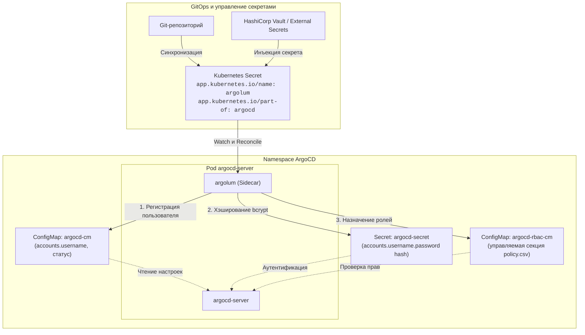

# ArgoCD Local Users Manager (`argolum`)

[](https://goreportcard.com/report/github.com/aleksandrsumkin/argolum)
[](LICENSE)

[English](README.md) | **Русский**

**`argolum`** — это легковесный Kubernetes-оператор и sidecar-контейнер для декларативного управления локальными пользователями ArgoCD по принципам GitOps (включая автоматизацию через Vault Secret Operator или External Secrets Operator) без необходимости использования тяжеловесного ArgoCD Operator.

---

## 🎯 Проблема, которую решает `argolum`

В стандартной архитектуре ArgoCD управление локальными пользователями разделено между несколькими ресурсами:
1. Имя пользователя, статус и разрешения объявляются в ConfigMap `argocd-cm` (`accounts.<username>`).
2. Пароль пользователя хранится в общем Secret `argocd-secret` в виде bcrypt-хэша (`accounts.<username>.password`).
3. Роли и права доступа назначаются в ConfigMap `argocd-rbac-cm` (`policy.csv`).

Это делает GitOps-управление локальными пользователями крайне неудобным:
* Невозможно безопасно закомитить сырой секрет в Git.
* Неудобно доставлять динамически генерируемые пароли из HashiCorp Vault.
* Регулярная ротация паролей в CI/CD пайплайнах требует ручных операций через CLI (`argocd account update-password`).

---

## 🚀 Решение

`argolum` отслеживает стандартные Kubernetes Secrets типа `Opaque` с метками:
```yaml
app.kubernetes.io/name: argolum
app.kubernetes.io/part-of: argocd
```

При появлении, изменении или удалении такого секрета `argolum`:
1. Автоматически хэширует пароль функцией `bcrypt` и обновляет `argocd-secret`.
2. Регистрирует пользователя и его статус (`enabled`, `apiKey`, `login`) в `argocd-cm`.
3. Записывает назначенные роли в выделенную секцию `policy.csv` в `argocd-rbac-cm`.
4. Использует Kubernetes Finalizer (`argolum.argoproj.io/finalizer`) для чистого удаления пользователя при удалении секрета.
5. Защищает системную учетную запись `admin` от любых изменений.
6. Выполняет периодическую обратную сверку (pruning) для удаления учетных записей, у которых нет управляющего секрета (опционально).



---

## 📋 Формат секрета пользователя

```yaml
apiVersion: v1
kind: Secret
metadata:
  name: argocd-local-user-jenkins
  namespace: argocd
  labels:
    app.kubernetes.io/name: argolum
    app.kubernetes.io/part-of: argocd
type: Opaque
stringData:
  username: jenkins                         # Обязательно (запрещено значение 'admin')
  password: myPlainSecretPassword123!       # Обязательно (хэшируется оператором через bcrypt)
  enabled: "true"                           # Обязательно ("true" или "false")
  apiKey: "true"                            # Обязательно (разрешение генерации JWT API токенов)
  login: "true"                             # Обязательно (разрешение входа через Web UI / CLI)
  roles: "proj:default:admin,role:readonly" # Опционально (список ролей через запятую)
```

---

## 🔒 Изоляция RBAC в `argocd-rbac-cm`

Все роли управляемых пользователей ведутся строго внутри выделенной секции `policy.csv`, ограниченной комментариями-маркерами:

```csv
p, role:org-admin, applications, *, */*, allow

# --- ARGOLUM MANAGED USERS BEGIN ---
g, jenkins, proj:default:admin
g, jenkins, role:readonly
# --- ARGOLUM MANAGED USERS END ---
```

Политики, описанные администратором за пределами этой секции, остаются нетронутыми.

---

## ⚙️ Быстрый старт (Sidecar в официальном Helm-чарте `argo-cd`)

Добавьте контейнер `argolum` в секцию `server.extraContainers` в вашем `values.yaml`:

```yaml
server:
  extraContainers:
    - name: argolum
      image: ghcr.io/aleksandrsumkin/argolum:latest
      imagePullPolicy: IfNotPresent
      env:
        - name: WATCH_NAMESPACE
          valueFrom:
            fieldRef:
              fieldPath: metadata.namespace
        - name: LOG_LEVEL
          value: "info"
        - name: LOG_FORMAT
          value: "json"
        - name: PRUNE_ORPHAN_USERS
          value: "false" # Установите "true" для автоматической очистки пользователей без секрета
        - name: METRICS_BIND_ADDR
          value: ":8090" # В режиме sidecar рекомендуется :8090 во избежание конфликта с argocd-server (:8080)
        - name: HEALTH_PROBE_BIND_ADDR
          value: ":8091" # В режиме sidecar рекомендуется :8091
      resources:
        requests:
          cpu: 20m
          memory: 32Mi
        limits:
          cpu: 100m
          memory: 64Mi
      securityContext:
        allowPrivilegeEscalation: false
        readOnlyRootFilesystem: true
        runAsNonRoot: true
        runAsUser: 65532
        capabilities:
          drop:
            - ALL
      livenessProbe:
        httpGet:
          path: /healthz
          port: 8091
        initialDelaySeconds: 15
        periodSeconds: 20
      readinessProbe:
        httpGet:
          path: /readyz
          port: 8091
        initialDelaySeconds: 5
        periodSeconds: 10
```

> ℹ️ **Права доступа:** Контейнер запускается в поде `argocd-server` и использует его стандартный ServiceAccount, который по умолчанию уже обладает необходимыми правами на работу с Secrets и ConfigMaps в своем namespace.

---

## 🛠️ Переменные окружения

| Переменная | По умолчанию | Описание |
| :--- | :--- | :--- |
| `WATCH_NAMESPACE` | `""` (текущий namespace) | Namespace для отслеживания ресурсов (пусто = namespace текущего пода) |
| `ARGOCD_CM_NAME` | `""` (автоопределение) | Имя ConfigMap `argocd-cm` |
| `ARGOCD_SECRET_NAME` | `""` (автоопределение) | Имя Secret `argocd-secret` |
| `ARGOCD_RBAC_CM_NAME` | `""` (автоопределение) | Имя ConfigMap `argocd-rbac-cm` |
| `LABEL_NAME` | `argolum` | Значение метки `app.kubernetes.io/name` |
| `LABEL_PART_OF` | `argocd` | Значение метки `app.kubernetes.io/part-of` |
| `BCRYPT_COST` | `10` | Вычислительная сложность bcrypt (от 4 до 31) |
| `PRUNE_ORPHAN_USERS` | `false` | Удалять локальных пользователей, для которых нет активного секрета |
| `PRUNE_INTERVAL` | `10m` | Интервал фоновой обратной сверки |
| `IGNORE_USERS` | `admin` | Пользователи (через запятую), которых запрещено удалять или изменять |
| `LOG_LEVEL` | `info` | Уровень логов: `debug`, `info`, `warn`, `error` |
| `LOG_FORMAT` | `json` | Формат логов: `json` или `text` |
| `METRICS_BIND_ADDR` | `:8080` | Адрес сервера метрик Prometheus |
| `HEALTH_PROBE_BIND_ADDR` | `:8081` | Адрес health probes (`/healthz`, `/readyz`) |

---

## 🧪 Разработка и тестирование

Запуск модульных тестов:
```bash
go test -v ./...
```

Сборка бинарного файла:
```bash
go build -o bin/argolum ./cmd/argolum
```

Сборка Docker-образа:
```bash
docker build -t argolum:latest .
```

---

## 📄 Лицензия

MIT License. См. [LICENSE](LICENSE).
